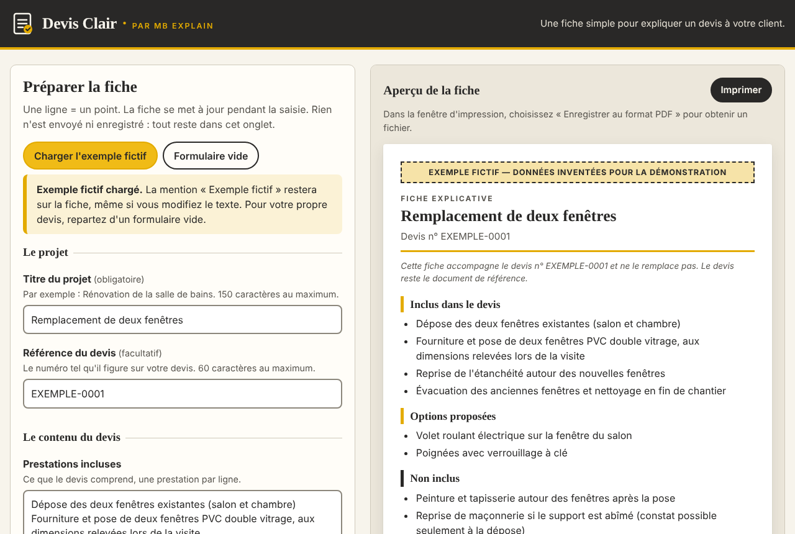

# Devis Clair · par MB Explain

Devis Clair aide un artisan ou une petite entreprise à expliquer un devis à son client. On saisit ce que le devis comprend, les options, les exclusions, les points encore à confirmer et les prochaines étapes. L'outil met tout cela en forme dans une fiche claire, qu'on imprime ou qu'on enregistre en PDF depuis le navigateur.

La fiche accompagne le devis, elle ne le remplace pas. Elle reprend uniquement ce qui a été saisi : aucun montant, délai, engagement ou détail technique n'est ajouté.

Tout se passe dans le navigateur. Pas de compte, pas de serveur, pas d'IA, pas de suivi : rien de ce que vous tapez ne quitte votre ordinateur.



> **In English.** Devis Clair is a small, free, open-source web app that helps tradespeople and small businesses explain a quote to their customers. You type what is included, the options, the exclusions, the points still to confirm and the next steps; it renders a clean, printable A4 explanation sheet (print or "Save as PDF" from your browser). It runs entirely in the browser: no account, no server, no AI calls, no tracking, no data storage. The interface is in French. MIT licensed (the "MB Explain" name and logo are not covered, see [MARQUE.md](MARQUE.md)).

## Fonctionnalités

- Formulaire en français : titre du projet, référence du devis (facultative), prestations incluses, options, exclusions, points à confirmer, prochaines étapes. Une ligne = un point.
- Aperçu de la fiche mis à jour pendant la saisie. Les rubriques vides n'apparaissent pas.
- Impression A4 soignée, sur plusieurs pages si besoin, et enregistrement en PDF par la fenêtre d'impression du navigateur.
- Mention sobre sur chaque fiche : elle accompagne le devis et ne le remplace pas.
- Exemple entièrement fictif (remplacement de deux fenêtres), signalé comme tel à l'écran et sur la fiche imprimée.
- Bouton « Formulaire vide » pour repartir de zéro. Une confirmation est demandée avant d'écraser une saisie.
- Adapté au mobile et utilisable entièrement au clavier : champs étiquetés, erreurs annoncées et reliées aux champs, contrastes lisibles.

## Lancer Devis Clair

**Le plus simple :** téléchargez le dépôt, puis ouvrez `index.html` dans votre navigateur (double-clic). Aucune installation n'est nécessaire.

**Avec un petit serveur local** (Node.js 20 ou plus récent) :

```bash
git clone https://github.com/MTM2904/devis-clair.git
cd devis-clair
npm start
```

Puis ouvrez http://127.0.0.1:8080/ . Le serveur n'écoute que sur votre ordinateur.

## Utilisation

1. Remplissez le titre et au moins une rubrique. Écrivez un point par ligne ; les puces (`-`, `•`) ou numéros (`1.`) tapés en début de ligne sont retirés, la fiche les remet d'elle-même.
2. Relisez l'aperçu.
3. Cliquez sur « Imprimer ». Pour un PDF, choisissez « Enregistrer au format PDF » comme imprimante.

Astuce : dans la fenêtre d'impression, décochez « En-têtes et pieds de page » pour ne pas imprimer l'adresse de la page.

## Vos données

- Le texte saisi reste dans l'onglet ouvert. Il n'est ni envoyé, ni enregistré automatiquement : pas de `localStorage`, pas de cookies, pas de base de données.
- Fermer ou recharger l'onglet efface la saisie. Le navigateur vous prévient avant de quitter la page si des champs sont remplis.
- La page n'appelle aucun service externe (ni police, ni statistiques, ni IA). Une politique de sécurité du contenu (CSP) l'interdit d'ailleurs : aucune connexion réseau n'est autorisée depuis la page.
- Le texte saisi est toujours affiché comme du texte, jamais interprété comme du HTML.
- Les PDF que vous enregistrez sont des fichiers ordinaires sur votre ordinateur : protégez-les comme vos devis.

## Limites connues

- Pas de sauvegarde : une fiche ne peut pas être rouverte pour être modifiée plus tard. Gardez votre texte ailleurs si vous voulez le réutiliser.
- Pas de montants, de calculs ni de TVA : ce n'est pas un logiciel de devis ou de facturation, et ce n'est pas son but.
- Interface et fiche en français uniquement.
- Pas de logo ni de coordonnées d'entreprise sur la fiche pour l'instant.
- Le rendu imprimé dépend un peu du navigateur. Il a été vérifié automatiquement dans Chromium ; Safari, Firefox et l'impression sur papier n'ont pas encore été testés.
- Il faut JavaScript pour l'aperçu.

## Structure

```
index.html            page unique (formulaire + aperçu)
assets/app.js         logique : lecture du formulaire, rendu de la fiche, confirmations
assets/styles.css     styles écran et impression A4
assets/icon.svg       icône de Devis Clair
scripts/serve.js      petit serveur local sans dépendance
tests/                tests de bout en bout (Playwright + axe-core)
```

Aucune dépendance n'est nécessaire pour utiliser l'application. Les dépendances de développement (`playwright`, `axe-core`) servent uniquement aux tests.

## Tests

```bash
npm install
npx playwright install chromium
npm test
```

Les tests vérifient notamment : le chargement sans erreur ni requête externe, la fidélité de la fiche, les champs vides, le contenu long sur plusieurs pages A4, les caractères spéciaux, les saisies qui ressemblent à du HTML, l'absence de stockage, le parcours au clavier, le format mobile et l'accessibilité automatique (axe-core). Le test d'impression longue utilise `pdftotext` (paquet `poppler-utils`) ; il est ignoré s'il est absent.

## Contribuer

Les contributions sont bienvenues : lisez [CONTRIBUTING.md](CONTRIBUTING.md). Pour un problème de sécurité, suivez [SECURITY.md](SECURITY.md). Les prochaines idées sont dans [ROADMAP.md](ROADMAP.md).

## Licence et marque

Le code est sous licence [MIT](LICENSE). Le nom « MB Explain », la mention « par MB Explain » et les logos de MB Explain ne sont pas accordés par cette licence : voir [MARQUE.md](MARQUE.md).
